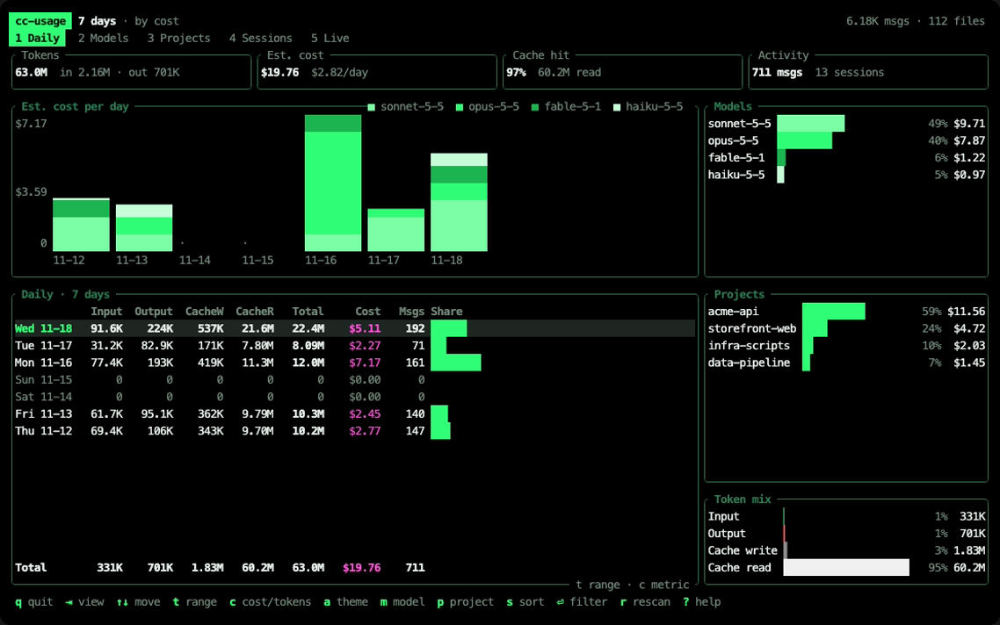

# development-tools

[](https://github.com/scottlandon/development-tools/actions/workflows/ci.yml)
[](LICENSE)

A collection of small, fast developer tools, written in Rust and built as a single Cargo workspace.
Each tool lives in its own crate under [`tools/`](tools) and ships as a standalone binary.

## Tools

| Tool | What it does |
|------|--------------|
| [`cc-usage`](tools/cc-usage) | A responsive terminal UI for your daily [Claude Code](https://claude.com/claude-code) token usage and API-equivalent cost: daily chart and table, per-model / per-project / per-session breakdowns, and a live tokens-per-minute graph. It re-flows to whatever size pane you run it in. |



<sub>Synthetic demo data (`cc-usage --demo`), not real usage.</sub>

More will land here over time.

## Install

**Prebuilt binary** (macOS and Linux, Apple silicon / Intel / arm64 / x86-64): download the archive for your
platform from the [latest release](https://github.com/scottlandon/development-tools/releases/latest), check it
against `SHA256SUMS` (or with `gh attestation verify`), unpack it, and put the binary on your `PATH`.

**From source** with a [Rust toolchain](https://rustup.rs) (1.88 or newer; the workspace uses the 2024 edition):

```sh
cargo install --locked --git https://github.com/scottlandon/development-tools cc-usage
```

or from a clone: `cargo install --locked --path tools/cc-usage`, or `cargo run --release -p cc-usage -- --demo` to try it on
synthetic data without installing.

Every tool has its own README with usage, flags and details.

## Platforms

macOS and Linux. CI builds and tests on both, and releases ship for Apple silicon, Intel Mac, and
x86-64 / arm64 Linux. Windows is not supported yet.

## Privacy

The tools run entirely on your machine. `cc-usage` only reads: it opens Claude Code's `*.jsonl` transcripts
(under `~/.claude/projects`) and nothing else, keeps only token counts, model names, timestamps and project
folder names, writes no files, and makes no network connections. Tests and CI enforce this.
[Details and a way to verify it yourself](tools/cc-usage/README.md#what-it-reads-exactly).

## Repository layout

```
.
├── Cargo.toml          workspace manifest (members = tools/*)
├── Cargo.lock          committed, so binary builds are reproducible
├── rust-toolchain.toml dev toolchain (stable + rustfmt + clippy)
├── rustfmt.toml        shared formatting rules
├── deny.toml           dependency policy (advisories, licences, sources, no network crates)
├── .github/            CI, release workflow, Dependabot, issue / PR templates
└── tools/
    └── cc-usage/       one crate per tool
```

## Development

```sh
cargo fmt --all                                 # format
cargo clippy --workspace --all-targets          # lint (kept warning-free)
cargo test --workspace                          # test
cargo deny check                                # advisories, licences (needs cargo-deny)
cargo build --release                           # optimised binaries in target/release/
```

To add a tool: `cargo new tools/<name>`. The workspace picks up `tools/*` automatically, and the new
crate can inherit the shared `edition`, `version`, `rust-version` and `license` with
`edition.workspace = true` etc. Lints are configured once in `[workspace.lints]` in the root `Cargo.toml`
(clippy pedantic plus a few restriction lints, `unsafe` forbidden); a new tool's `Cargo.toml` must opt in
with `[lints]` and `workspace = true`.

## Contributing

Issues and pull requests are welcome; see [CONTRIBUTING.md](CONTRIBUTING.md). Please report security
problems privately, as described in [SECURITY.md](SECURITY.md).

## License

[MIT](LICENSE) © 2026 Scott Landon
