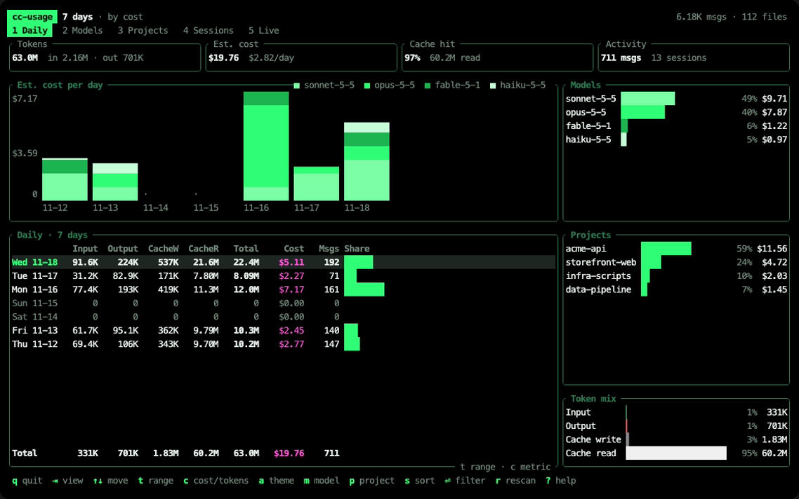
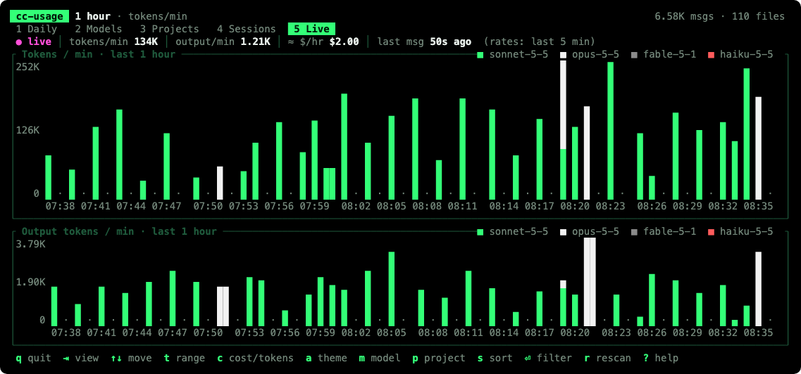
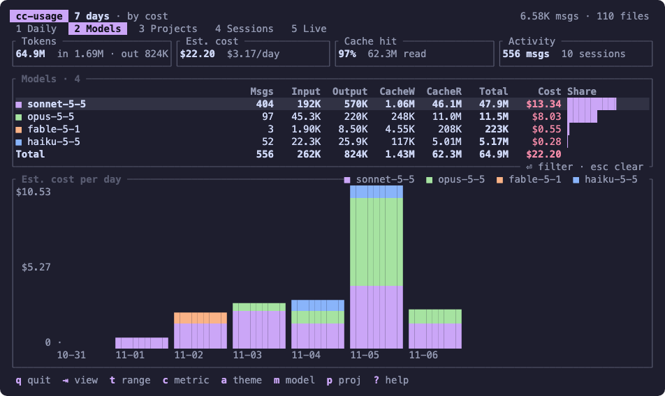
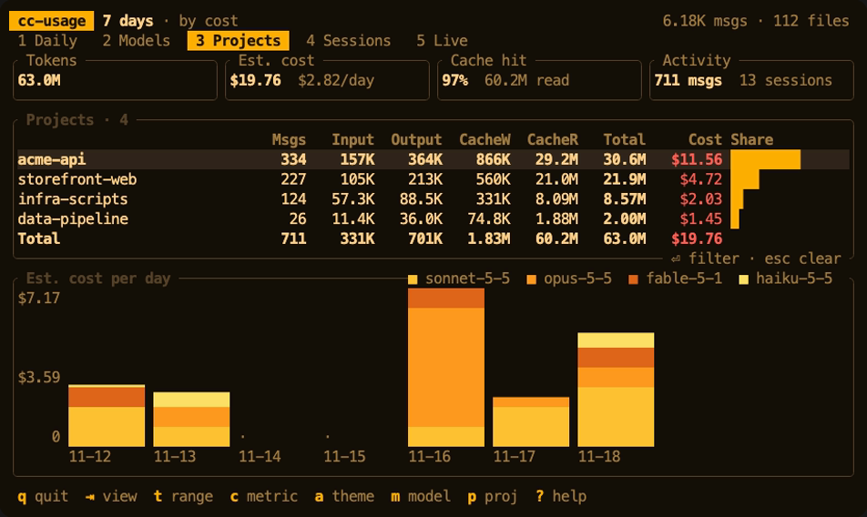

# cc-usage

A terminal UI that shows your daily [Claude Code](https://claude.com/claude-code) token usage and the API-equivalent
cost, by reading the transcript files Claude Code already writes on your machine.



<sub>Every screenshot here is synthetic data from `cc-usage --demo`, not real usage.</sub>

**It only reads.** It writes no files, makes no network connections, runs no other programs, and opens
nothing except Claude Code's `*.jsonl` transcripts. [What it reads, exactly](#what-it-reads-exactly) and
[how those promises are enforced](#what-it-never-does) are spelled out below.

## Install

You need macOS or Linux. Windows is not supported.

**Prebuilt binary.** Download the archive for your platform from the
[releases page](https://github.com/scottlandon/development-tools/releases/latest)
(`aarch64-apple-darwin` = Apple silicon, `x86_64-apple-darwin` = Intel Mac, and the two `linux-musl`
builds for x86-64 and arm64 Linux). Check it against `SHA256SUMS`, unpack, and put `cc-usage` on your `PATH`:

```sh
shasum -a 256 -c --ignore-missing SHA256SUMS
tar xzf cc-usage-*-aarch64-apple-darwin.tar.gz
mkdir -p ~/.local/bin && install -m 755 cc-usage-*/cc-usage ~/.local/bin/
```

Each archive carries a signed build-provenance attestation, so you can check it was built by this repo's
release workflow from the tagged source: `gh attestation verify <archive> --repo scottlandon/development-tools`.

If you download in a browser on macOS, Gatekeeper quarantines the unsigned binary; clear it with
`xattr -d com.apple.quarantine ~/.local/bin/cc-usage` (downloads via `curl` or `gh` aren't affected).

**From source.** Needs a [Rust toolchain](https://rustup.rs), version 1.88 or newer:

```sh
cargo install --locked --git https://github.com/scottlandon/development-tools cc-usage
# or, from a clone of the repo:
cargo install --locked --path tools/cc-usage
```

## Run

```sh
cc-usage                  # the TUI, last 7 days
cc-usage -r 30d           # start on 30 days
cc-usage --print          # plain-text report to stdout, for pipes and scripts
cc-usage --demo           # synthetic data: reads no transcripts, safe to screen-share
```

Press `?` inside for the key bindings and `q` to quit.

| Option | Meaning |
|--------|---------|
| `-r, --range <1d\|7d\|30d\|90d\|all>` | Initial time range (default `7d`) |
| `--print` | Print a plain-text report and exit; no TUI |
| `--days <N>` | With `--print`: number of days (default 14) |
| `--projects-dir <PATH>` | Read this directory instead of the defaults; repeatable |
| `--refresh <SECS>` | Rescan interval (default 3, minimum 0.5) |
| `--theme <NAME>` | `mainframe` (default), `amber`, `catppuccin`, `daylight`; `a` / `A` cycle in the TUI |
| `--color <auto\|truecolor\|256>` | Colour depth; `auto` reads `$COLORTERM` |
| `--demo` | Use synthetic data instead of reading any transcripts |
| `-h`, `-V` | Help, version |

There is no config file and nothing is remembered between runs; pass `--theme` (an alias is handy) to choose
a theme each time.

## What it reads, exactly

**Where it looks.** Claude Code writes one transcript per session. cc-usage looks in:

1. `$CLAUDE_CONFIG_DIR/projects`, or `~/.claude/projects` when that variable isn't set, and
2. `~/Library/Developer/Xcode/CodingAssistant/ClaudeAgentConfig/projects`, if it exists (Xcode's Claude agent).

`--projects-dir <PATH>` replaces both. Each directory is walked recursively.

**Which files it opens.** Regular files whose name ends in `.jsonl`, and nothing else. Symbolic links are
not followed, so a link cannot lead it outside the transcript directory. Credentials, settings, history,
saved tool output (`.txt`, `.json`), `.env` files and anything else in or next to those directories are never
opened. This is covered by tests.

**What it takes from them.** A transcript line holds one event, and the lines that carry usage are the
assistant's messages. Only lines containing the text `"usage"` are parsed; the rest are skipped without being
looked at. From each parsed line cc-usage takes exactly:

| Field | Used for |
|-------|----------|
| `timestamp` | which day / minute the message belongs to |
| `message.model` | per-model breakdown and pricing |
| `message.usage.input_tokens`, `output_tokens`, `cache_read_input_tokens`, `cache_creation_input_tokens` (split by `cache_creation.ephemeral_5m_input_tokens` / `ephemeral_1h_input_tokens`) | the token counts |
| `message.id`, `requestId` | de-duplication (Claude Code writes a message several times while it streams; the copy with the most output tokens wins). Only a hash of the pair is kept. |
| `cwd` | the project name: just the last folder (`~` for your home directory). The full path is not kept. |

The session is the transcript's file name, and the project directory name is the fallback when `cwd` is absent.

**What happens to the rest.** The transcript lines also contain your conversation: prompts, replies, tool
inputs and tool output, which can include secrets that passed through a session. To find the numbers, cc-usage
reads each file into memory and its JSON parser steps over everything else in the line. None of it is stored,
displayed, logged or written. After parsing, all that exists is the table above (numbers, model name,
timestamps, a hash, a folder name). A test feeds it a line full of fake keys and checks that none survive.

**When.** The first scan happens at launch and takes a moment on a large history (roughly half a second for
750 MB on an Apple-silicon laptop). After that a background thread rescans every few seconds, parsing only
bytes added since the last pass (it remembers an offset per file). `r` rescans immediately. Everything is
held in memory and is gone when you quit.

**Cost.** Token counts times a built-in price table, so it's an **API-equivalent estimate**: subscription plans
aren't billed per token. Cache writes use the 5-minute (1.25×) and 1-hour (2×) rates from the transcript's
`cache_creation` breakdown. Messages sent in fast mode (`usage.speed`) are priced at the fast-mode rates; US-only
data residency (1.1×) is not modelled. Models with no known price show `n/a` and are left out of cost, never priced at $0.
The table (`src/pricing.rs`) was last checked against Anthropic's published pricing on the date shown in
`cc-usage --help` and the `?` overlay. It handles the models whose cache reads aren't 0.1× input and Haiku 5.5's
higher rate for prompts over 100k tokens. To change a price, edit that file and rebuild.

**If the format changes.** If transcript files are found but none of them yields a usage record, cc-usage says
so on screen (and under `--print`) instead of showing zeros: either the sessions are new, or Claude Code's log
format has changed. In that case please open an issue.

**Limits.** cc-usage can only see transcripts that exist on disk. If they are deleted (by you or by Claude Code's
own cleanup), those days disappear from the view. Sessions that don't write local transcripts aren't
counted. A message shows up when Claude Code finishes writing it, not token by token. "Day" is your local calendar day.

## What it never does

- **Read anything but transcripts.** No keys, tokens, credentials, settings, history or shell files. The only
  environment variables it reads are `HOME`, `CLAUDE_CONFIG_DIR` (to find the transcripts) and `COLORTERM`
  (to choose colour depth).
- **Write anything.** No cache, config, theme or log file. The only output is the terminal (or stdout for `--print`).
- **Use the network.** No sockets, no telemetry, no update check. The dependency list contains no network
  library, and CI fails if one appears.
- **Run other programs**, or contain `unsafe` code.

These aren't just claims. `tests/policy.rs` scans the production source and fails the build if it gains a file
write, a socket, a subprocess, a filesystem call outside the scanner, an unlisted environment variable or an
unreviewed dependency; `deny.toml` bans HTTP, TLS and async-network crates from the dependency tree; and the
scanner has tests for the file-type and symlink rules above.

**Check it yourself** (macOS). Run the real binary with the network blocked, all file writes blocked and your
key and credential locations unreadable. It still produces the same report:

```sh
cat > /tmp/readonly.sb <<EOF
(version 1)
(allow default)
(deny network*)
(deny file-write*)
(allow file-write* (literal "/dev/null"))
(deny file-read*
  (subpath "$HOME/.ssh") (subpath "$HOME/.aws") (subpath "$HOME/.gnupg") (subpath "$HOME/.config")
  (literal "$HOME/.claude.json") (literal "$HOME/.claude/settings.json") (literal "$HOME/.claude/.credentials.json"))
EOF
sandbox-exec -f /tmp/readonly.sb cc-usage --print --days 3
```

## Views

`1` Daily (stacked chart by model + table) · `2` Models · `3` Projects · `4` Sessions · `5` Live.

Keys: `Tab`/`←` `→`/`h` `l` switch view · `↑` `↓`/`j` `k` move · `PgUp` `PgDn` `g` `G` page / first / last ·
`t` / `T` change time range · `c` cost ⇄ tokens · `m` / `p` cycle model / project filter · `Enter` filter by the
selected model or project · `Esc` clear filters · `s` sort sessions · `a` / `A` theme · `r` rescan · `?` help · `q` quit.

**Live** shows tokens per minute (stacked by model) and output tokens per minute over a sliding window; `t` / `T`
switch 15 min / 1 h / 6 h / 24 h. It redraws every second, with a `● live` / `○ idle` light, current rates
(last 5 minutes), an estimated $/hr and the time since the last message.



## Themes

| Theme | Look |
|-------|------|
| `mainframe` (default) | Pure black, white readout, electric green accent |
| `amber` | Warm black with amber-phosphor text |
| `catppuccin` | [Catppuccin Mocha](https://catppuccin.com/palette) base, lavender-white text, mauve accent (palette MIT, © Catppuccin) |
| `daylight` | Light: warm paper ground, teal accent |

| Catppuccin | Amber |
|---|---|
|  |  |

Every theme paints its own background. Colours are 24-bit when `$COLORTERM` says truecolor, otherwise mapped to
the nearest xterm-256 colour (force either with `--color truecolor|256`). Tests hold every theme to contrast floors.

## Responsive layout and Herdr

Everything is computed from the pane size on every frame, so resizing a pane re-flows the UI live. That makes it
a good fit for a side pane in [Herdr](https://herdr.dev), next to an agent:

```sh
herdr pane split --current --direction right    # new pane beside this one
cc-usage                                        # run it there
```

| Pane | Layout |
|------|--------|
| ≥130 cols, ≥14 rows | chart + table + sidebar (models, projects, token mix) |
| 80–129 cols | chart + table, full columns |
| <80 cols | fewer columns, merged cache columns, chart rebinned |
| <24 rows | stat cards collapse to a one-line strip, then tabs/chart drop |
| <9 rows or <36 cols | compact mode: one summary line + recent days (or top models) |

## Demo mode

`--demo` runs the full UI on invented data (made-up projects and token counts from a fixed seed). It scans
nothing and reads no transcripts. The screenshots above were taken from it.
